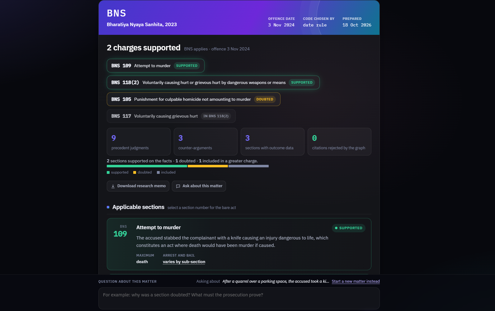
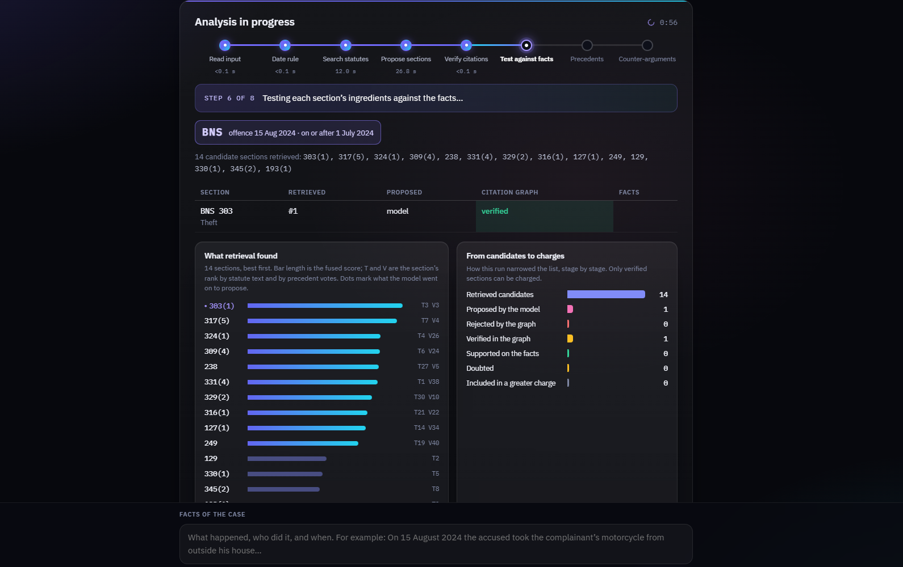

# Pramana

**Citation-verified, fully local AI legal research for Indian criminal law, across the IPC → BNS transition.**

Given the facts of a case and the offence date, Pramana picks the criminal code that applies, identifies the sections the facts disclose, **checks every section against a citation graph built from the statutes themselves**, finds precedent judgments, drafts likely defence counter-arguments and shows how appeals on those sections were decided. It runs entirely offline on one laptop: no API keys, no cloud model, and no case facts leave the machine.

<p align="center"></p>

> B.Tech CSE major project, I.K. Gujral Punjab Technical University · Suvan Sharma, Team The Spartan Coders · Mentor: Aditya Sharma

**Contents:** [Why](#why) · [Results](#results-at-a-glance) · [How it works](#how-it-works) · [Getting started](#getting-started) · [Using it](#using-it) · [Repository layout](#repository-layout) · [Evaluation](#evaluation) · [Limitations](#limitations) · [Data and licences](#data-sources-and-licences)

---

## Why

- **India renumbered its criminal law on 1 July 2024.** The Bharatiya Nyaya Sanhita (BNS) replaced the Indian Penal Code (IPC) for offences on or after that date; earlier offences stay under the IPC. The same number now means different crimes: IPC 302 is murder, BNS 302 is wounding religious feelings; BNS 303 is theft; the BNS has no section 420.
- **AI models invent citations.** Asked what BNS 303 covers, the 4B model used here described a bomb-threat offence. In legal research a wrong section is not a cosmetic error.
- **Client facts are confidential.** They should not be sent to a cloud AI service, so the system runs on the lawyer's own machine.

## Results at a glance

| What was measured | Result |
|---|---|
| Invented or wrong-code sections that reached a report, across every evaluation | **0** |
| Citation gate: real vs fabricated section numbers (incl. BNS 420 and 498A) | **20 / 20** |
| Offence-date routing (10 cases × 3 runs) | **30 / 30** |
| Model citing from memory: citations caught / cases recovered within 2 retries | **20 of 68** caught · **6 / 6** recovered |
| IL-TUR statute identification (ACL 2024), 100 test documents, macro-F1 | **11.8** zero-shot, vs 28.1 for the best supervised model |
| Automated tests | **422** passing |

Every number comes from a saved run; see [`stuff/docs/evaluation_results.md`](stuff/docs/evaluation_results.md).

## How it works

<p align="center"></p>

The guiding rule: **the language model proposes; deterministic code decides what is real.**

1. **Offence-date router** (plain code): before 1 July 2024 → IPC, on or after → BNS. Ambiguous dates are never guessed.
2. **Retrieval**: BGE-M3 embeddings over statute text, fused by reciprocal rank fusion with *votes* from similar judgments. A guardrail returns "insufficient data" when nothing relevant is close.
3. **Node 1** (local LLM) proposes sections; **Node 2** verifies each one in the NetworkX citation graph of the routed code and sends rejections back with the reason (at most two retries).
4. **Node 2b** checks that each real section actually fits the facts (verbatim quotes, two passes, plus deterministic legal rules). Doubts are shown, never hidden.
5. **Node 3** finds precedents through graph edges; for a BNS charge it also crosses a reviewed IPC→BNS mapping, because the new code has almost no case law yet. **Node 5** summarises appeal outcomes with plain SQL, in parallel.
6. **Node 4** drafts counter-arguments; a final pass re-checks every section, precedent label and quotation they use.

| Layer | Choice | Why |
|---|---|---|
| Language model | `qwen3.5:4b` on [Ollama](https://ollama.com), local | private, free, fits a 4 GB GPU |
| Embeddings | `BAAI/bge-m3` (1024-d, fp16) | won a measured bake-off over a legal-domain model (recall@3 0.533 vs 0.20) |
| Vector store | ChromaDB, 4 collections | local, persistent, metadata filters |
| Citation graph | NetworkX | exact existence check for every citation |
| Outcomes | SQLite | exact counts, no model involved |
| Orchestration | LangGraph | retry edge, parallel nodes, a shared state checked step by step |
| Backend / UI | FastAPI + an offline web app | live progress; the page makes no outside requests |

On a 4 GB GPU the embedder and the LLM take turns: every run unloads the LLM, embeds, frees the embedder, then generates.

## Getting started

### Requirements

- Windows 10/11 (developed and tested on Windows 11), Python **3.12**
- NVIDIA GPU with **4 GB+** VRAM and CUDA (tested on an RTX 3050 Ti Laptop GPU), 16 GB RAM
- About **20 GB** of free disk
- [Ollama](https://ollama.com) and a free [Hugging Face](https://huggingface.co) account (two datasets are gated)

### 1. Install

```powershell
git clone https://github.com/Suvansharma69/nayasetu.git
cd nayasetu
python -m venv venv
venv\Scripts\activate
pip install torch --index-url https://download.pytorch.org/whl/cu124   # the CUDA build, first
pip install -r requirements.txt                                          # exact versions: requirements.lock.txt
ollama pull qwen3.5:4b
copy .env.example .env      # then edit the cache paths, and add HF_TOKEN=<your token>
```

### 2. Get the data

The corpus is built from public sources and is **not stored in this repository**. Place each file at the path shown:

| Source | Get it from | Put it at |
|---|---|---|
| IPC, 1860 (structured) | [civictech-India/Indian-Law-Penal-Code-Json](https://raw.githubusercontent.com/civictech-India/Indian-Law-Penal-Code-Json/main/ipc.json) | `data/raw/statutes/ipc.json` |
| IPC, official consolidated text | [Goa Police copy of the Legislative Department text](https://citizen.goapolice.gov.in/documents/10184/1794152/ipc.pdf/f7f2c816-63fe-450f-8874-0a5552959c45) | `data/raw/statutes/ipc_official/ipc_goa.pdf` |
| BNS, 2023 (Gazette of India) | [MHA](https://www.mha.gov.in/sites/default/files/250883_english_01042024.pdf) | `data/raw/statutes/bns_mha.pdf` |
| Supreme Court judgments 2023–2026 | AWS Open Data, `indian-supreme-court-judgments` | `python scripts\fetch_judgments.py` |
| High Court judgments | [L-NLProc/NyayaAnumana-Classification-Data](https://huggingface.co/datasets/L-NLProc/NyayaAnumana-Classification-Data) (gated: accept its terms), file `test/2020_2024_single.zip` | `data/raw/nyaya_anumana/test/2020_2024_single.zip` |
| BNSS First Schedule (arrest and bail) | [MHA](https://www.mha.gov.in/sites/default/files/2024-04/250884_2_english_01042024.pdf) | `data/raw/schedules/bnss_gazette.pdf` |
| CrPC First Schedule | [CRPF](https://crpf.gov.in/writereaddata/images/pdf/crpc1973.pdf) | `data/raw/schedules/crpc_crpf.pdf` |
| Embedding model | `BAAI/bge-m3` | `python scripts\fetch_models.py` |
| *Evaluation only:* IL-TUR (gated) | [Exploration-Lab/IL-TUR](https://huggingface.co/datasets/Exploration-Lab/IL-TUR) | `python scripts\fetch_iltur.py` |
| *Evaluation only:* external court orders | [Hanno-Labs/indian-ipc-statute-identification](https://huggingface.co/datasets/Hanno-Labs/indian-ipc-statute-identification) (CC-BY-4.0) | `data/raw/eval/hanno_ipc_lsi/train.parquet` |

The reviewed IPC→BNS mapping, the First Schedule tables and the statute patches are already committed in `data/mappings/`.

### 3. Build

```powershell
venv\Scripts\python.exe scripts\build_corpus.py     # data/raw -> data/processed, validated against a schema
venv\Scripts\python.exe scripts\build_index.py      # ChromaDB, ~25 min on the GPU
venv\Scripts\python.exe scripts\build_graph.py      # citation graph
venv\Scripts\python.exe scripts\build_outcomes.py   # outcomes table
venv\Scripts\python.exe -m pytest tests -q          # 422 tests
```

### 4. Run

```
run_web.bat
```

It starts Ollama if needed, starts the server and opens `http://127.0.0.1:8000/` as soon as it is ready (running it again just reopens the page). A live analysis takes about 1–3 minutes on a 4 GB GPU; the six saved samples open instantly.

## Using it

Describe the case in plain words; the offence date is read from the text, and the page asks when it cannot tell. You can also attach an FIR or court order as a PDF.

<p align="center"></p>

Every report opens with a summary: each charge as **supported**, **doubted** (a real section the applicability check doubts, with the reason) or **included** in a greater charge, plus precedents, counter-arguments and appeal outcomes. Citations the model proposed that the graph rejected are listed, struck through. Beside each report: the bare-act text of any section, an IPC↔BNS word-level comparison, punishment and bail from the official First Schedules, follow-up questions answered only from the report, precedent summaries and a printable research memo. A citation-graph explorer and an evaluation dashboard are one click away.

**Saved samples:** motorcycle theft (BNS 303, precedent via IPC 379), group assault with an iron rod (rioting doubted: it needs five people, the facts show three), fake job scam, OTP impersonation fraud, knife stabbing (culpable homicide doubted: no death), and a civil security-deposit dispute (no offence charged).

**API** (interactive docs at `http://127.0.0.1:8000/docs`):

| Endpoint | Purpose |
|---|---|
| `POST /analyze` `{"facts", "offence_date": "YYYY-MM-DD"}` | full analysis → report |
| `POST /jobs`, `GET /jobs/{id}` | the same, with live stage-by-stage progress |
| `GET /section/{code}/{s}`, `GET /compare/{code}/{s}` | bare act; IPC↔BNS comparison |
| `GET /graph/{code}/{s}`, `GET /stats` | citation-graph neighbourhood; dashboard figures |
| `POST /ask`, `POST /summarise`, `POST /pdf` | follow-up questions; precedent summary; PDF text |
| `GET /health` | Ollama reachable? graph and outcomes table present? |

## Repository layout

Code and project material are kept apart: everything that runs is at the top level; everything written for people to read is under `stuff/`.

```
src/              the system
  ingest/           statutes (IPC JSON, BNS gazette PDF), judgments, chunking, section extraction
  retrieval/        BGE-M3 embedder, ChromaDB store, rank fusion with precedent votes
  graph/            NetworkX citation graph: verify_section, verify_case, precedents, IPC<->BNS bridge
  pipeline/         router, guardrail, LangGraph nodes 1-5, legal rules, applicability check, LLM client
  api/              FastAPI app, report builder, lawyer tools, follow-up assistant
  eval/             IL-TUR scoring
app/              web interface (app/web), saved sample reports, Streamlit app
data/mappings/    reviewed IPC->BNS map, First Schedules, statute patches (committed)
scripts/          build, fetch, evaluation and calibration scripts
tests/            pytest suite, mirrors src/
stuff/            project material (not needed to run the system)
  docs/             project guide, paper, synopsis, evaluation reports and run records
  presentation/     the animated slide deck (open stuff/presentation/index.html)
run_web.bat       start the app
CLAUDE.md         the full design record and decision log
```

## Evaluation

Each result is reproduced by one script; per-case records are committed in `stuff/docs/` beside each summary.

| Result | Command |
|---|---|
| Embedder bake-off | `python scripts\embedding_bakeoff.py` |
| Phase 4 gate (routing, retry loop) | `python scripts\run_phase4.py --reps 3` |
| Catch rate, real court orders | `python scripts\eval_phase6.py all` |
| IL-TUR statute identification | `python scripts\eval_lsi.py --split test --n 100` |
| Hand-written sets | `python scripts\score_runs.py <fixture> <runs.jsonl>` |

Development decisions were made on development sets only; held-out sets were written before each change and scored once, and the IL-TUR test split was run once at the end.

## Limitations

- **Choosing sections is the weak part; the citation check is not.** The model sometimes proposes extra sections that exist but do not apply. The applicability check marks many of them as doubted, not all.
- **Below the supervised state of the art on IL-TUR** (11.8 vs 28.1 macro-F1). Those models are trained on the task; Pramana is zero-shot with a 4B model.
- **Analytics are appeal outcomes, not conviction rates.** Sentence ranges are not extracted.
- **The IPC→BNS mapping and the hand-written test keys were prepared with AI assistance** and have not yet been reviewed by a practising lawyer.
- **Runs are not perfectly repeatable**: the same facts can occasionally give a different extra section. English text only; scanned documents are not read.

## Documentation

| | |
|---|---|
| [`stuff/docs/PROJECT_GUIDE.md`](stuff/docs/PROJECT_GUIDE.md) (also `.pdf`) | design, data, results, problems met, question bank |
| [`stuff/docs/paper/`](stuff/docs/paper/) | research paper, IEEE conference format (`pramana.tex`, `.pdf`) |
| [`stuff/docs/synopsis/`](stuff/docs/synopsis/) | project synopsis, Word and PDF |
| [`stuff/presentation/`](stuff/presentation/) | animated slide deck with speaker notes and a PDF backup |
| [`stuff/docs/README.md`](stuff/docs/README.md) | index of the reports and run records |
| [`CLAUDE.md`](CLAUDE.md) | the full design record and decision log |

## Data sources and licences

- **Statutes** (IPC, BNS, BNSS, CrPC) are Government of India publications.
- **Supreme Court judgments** come from the AWS Open Data registry (`indian-supreme-court-judgments`).
- **NyayaAnumana** and **IL-TUR** are gated datasets used under their terms; their content is not redistributed here. The committed IL-TUR run records hold only document IDs and labels.
- **Hanno-Labs/indian-ipc-statute-identification** is used under CC-BY-4.0.
- Fonts in `app/web/static/fonts/` and `stuff/presentation/fonts/` are IBM Plex and Spectral (SIL Open Font License).

## Authors and acknowledgements

Suvan Sharma, Team The Spartan Coders, Department of Computer Science and Engineering, I.K. Gujral Punjab Technical University, under the guidance of Aditya Sharma. The code, data processing and documentation were developed with the assistance of an AI coding agent (Claude Code), directed by the author; `CLAUDE.md` is the working record of that process.

## Licence

No open-source licence has been chosen yet. Until one is added, all rights are reserved.

---

*A research aid, not legal advice.*
