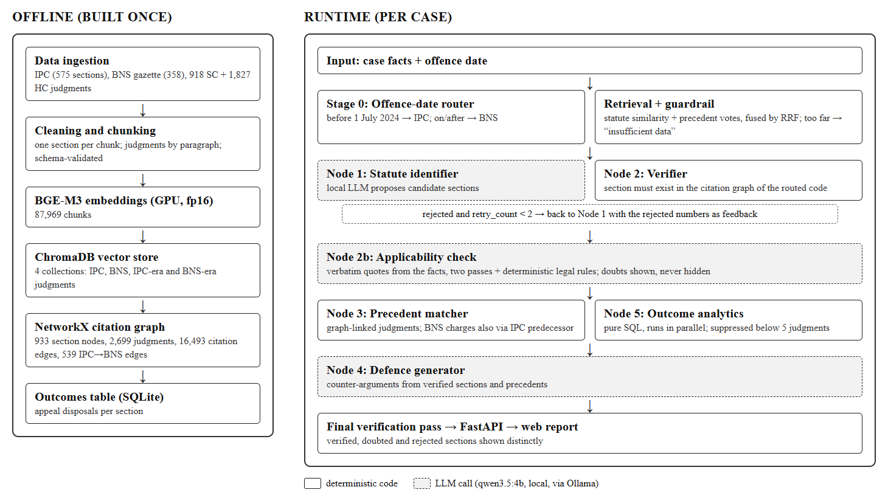

# Pramana

**Citation-verified, fully local AI legal research for Indian criminal law, across the IPC → BNS transition.**

A lawyer enters the facts of a case and the offence date. Pramana picks the criminal code that applies, identifies the sections the facts disclose, **checks every section against a citation graph built from the statutes themselves**, finds precedent judgments, drafts likely defence counter-arguments and shows how appeals on those sections were decided. Everything runs offline on one laptop, at zero cost: no API keys, and no case facts leave the machine.

> Major project · Suvan Sharma, Team The Spartan Coders · I.K. Gujral Punjab Technical University · Mentor: Aditya Sharma

<p align="center"></p>

---

## Why it exists

- **India renumbered its criminal law on 1 July 2024.** The Bharatiya Nyaya Sanhita (BNS) replaced the Indian Penal Code (IPC) for offences on or after that date; earlier offences stay under the IPC. The same number now means different crimes: IPC 302 is murder, BNS 302 is wounding religious feelings; BNS 303 is theft; BNS has no section 420.
- **AI models invent citations.** Asked what BNS 303 covers, the 4B model used here described a bomb-threat offence. In legal research a wrong section is not a cosmetic error.
- **Client facts are confidential.** They should not be sent to a cloud AI service, so the system has to run on the lawyer's own machine.

## Results at a glance

| What was measured | Result |
|---|---|
| Invented or wrong-code sections that reached a report, across every evaluation | **0** |
| Citation gate: real vs fabricated section numbers (incl. BNS 420, 498A) | **20 / 20** |
| Offence-date routing (10 cases × 3 runs) | **30 / 30** |
| Model citing from memory: citations caught / cases recovered within 2 retries | **20 of 68** caught · **6 / 6** recovered |
| IL-TUR statute identification (ACL 2024), 100 test documents, macro-F1 | **11.8** zero-shot, vs 28.1 for the best supervised model |
| Automated tests | **422** passing |

Full records and how to reproduce each number: [`docs/evaluation_results.md`](docs/evaluation_results.md).

## How it works

<p align="center"></p>

The guiding rule: **the language model proposes; deterministic code decides what is real.**

1. **Offence-date router** (plain code): before 1 July 2024 → IPC, on or after → BNS. Ambiguous dates are never guessed.
2. **Retrieval**: BGE-M3 embeddings over statute text, fused by reciprocal rank fusion with *votes* from similar judgments. A guardrail returns "insufficient data" when nothing relevant is close.
3. **Node 1** (local LLM) proposes sections; **Node 2** verifies each one in the NetworkX citation graph of the routed code, and sends rejections back with the reason (at most two retries).
4. **Node 2b** checks that each real section actually fits the facts (verbatim quotes, two passes, plus deterministic legal rules). Doubts are shown, never hidden.
5. **Node 3** finds precedents through graph edges; for a BNS charge it also crosses the reviewed IPC→BNS mapping, because the new code has almost no case law yet. **Node 5** summarises appeal outcomes with pure SQL, in parallel.
6. **Node 4** drafts counter-arguments; a final pass re-checks every section, precedent label and quotation they use.

On the 4 GB GPU the embedder and the LLM take turns: every run unloads the LLM, embeds, frees the embedder, then generates.

## Quick start

**Requirements:** Windows 10/11, Python 3.12, an NVIDIA GPU with 4 GB or more (CUDA), ~20 GB of disk, and [Ollama](https://ollama.com).

```powershell
python -m venv venv
venv\Scripts\activate
pip install torch --index-url https://download.pytorch.org/whl/cu124   # CUDA build first
pip install -r requirements.txt                                          # exact versions: requirements.lock.txt
ollama pull qwen3.5:4b
```

The corpus, vector index, citation graph and outcomes table are build artefacts and are not in the repository; build them once with the steps under [Rebuild](#rebuild). Then:

```
run_web.bat
```

It starts Ollama if needed, starts the server and opens `http://127.0.0.1:8000/` as soon as it is ready (running it again just reopens the page). Describe the case in plain words; the offence date is read from the text, and the page asks when it cannot tell. A live analysis takes about 1–3 minutes; the six saved samples open instantly. The older Streamlit page is available through `run_demo.bat`.

<p align="center"></p>

### Saved samples

| Sample | What it shows |
|---|---|
| Motorcycle theft (BNS) | the worked example: BNS 303 verified; precedent comes through IPC 379, because no BNS theft case has reached an appeal yet |
| Group assault (IPC) | common intention (34) and grievous hurt by a weapon (326); rioting (148) **doubted**, because it needs five or more persons and the facts show three |
| Fake job scam (IPC) | cheating (420) and forgery for cheating (468); 417 shown as included in 420 |
| OTP impersonation fraud (BNS) | cheating (318) and cheating by personation (319); forgery and stolen-property sections doubted, each with its reason |
| Knife stabbing (BNS) | attempt to murder (109) and hurt by a dangerous weapon (118); culpable homicide (105) doubted, as no death occurred |
| Security deposit (civil) | no offence charged; a warning that the facts look civil, with the nearest sections listed for review only |

**Reading a report:** *supported* = in the citation graph and supported by the facts; *doubted* = a real section the applicability check doubts (the reason is shown); *struck through* = a citation the model proposed that the graph rejected.

**Lawyer tools beside each report, all local:** bare-act text of any section; an IPC↔BNS word-level comparison; punishment and bail from the official First Schedules; PDF upload of an FIR or order; follow-up questions answered only from the report; precedent summaries; a printable research memo; a citation-graph explorer and an evaluation dashboard.

### API

| Endpoint | Purpose |
|---|---|
| `POST /analyze` `{"facts", "offence_date": "YYYY-MM-DD"}` | full analysis → report |
| `POST /jobs`, `GET /jobs/{id}` | the same, with live stage-by-stage progress |
| `GET /section/{code}/{s}`, `GET /compare/{code}/{s}` | bare act; IPC↔BNS comparison |
| `GET /graph/{code}/{s}`, `GET /stats` | citation-graph neighbourhood; dashboard figures |
| `POST /ask`, `POST /summarise`, `POST /pdf` | follow-up questions; precedent summary; PDF text |
| `GET /health` | Ollama reachable? graph and outcomes table present? |

Interactive documentation is served at `http://127.0.0.1:8000/docs`.

## Project structure

```
src/
  ingest/      statutes (IPC JSON, BNS gazette PDF), judgments, chunking, section extraction
  retrieval/   BGE-M3 embedder, ChromaDB store, rank fusion with precedent votes
  graph/       NetworkX citation graph: verify_section, verify_case, precedents, IPC<->BNS bridge
  pipeline/    router, guardrail, LangGraph nodes 1-5, legal rules, applicability check, LLM client
  api/         FastAPI app, report builder, lawyer tools, follow-up assistant
  eval/        IL-TUR scoring
app/           web interface (app/web), saved sample reports, Streamlit app
data/mappings/ the reviewed IPC->BNS map, First Schedules, statute patches (committed)
scripts/       build, fetch, evaluation and calibration scripts
tests/         unit and integration tests (pytest), mirrors src/
docs/          project guide, paper, synopsis, evaluation records (see docs/README.md)
presentation/  the animated slide deck (open presentation/index.html)
```

## Rebuild

```
venv\Scripts\python.exe scripts\build_corpus.py     # data/raw -> data/processed (validated against a schema)
venv\Scripts\python.exe scripts\build_index.py      # ChromaDB, ~25 min on the GPU
venv\Scripts\python.exe scripts\build_graph.py      # citation graph
venv\Scripts\python.exe scripts\build_outcomes.py   # outcomes table for analytics
venv\Scripts\python.exe scripts\run_demo_cases.py   # refresh the saved sample reports
venv\Scripts\python.exe -m pytest tests -q          # 422 tests
```

Data sources, sizes and the reasons behind each choice are in [`docs/PROJECT_GUIDE.md`](docs/PROJECT_GUIDE.md).

## Documentation

| Document | Contents |
|---|---|
| [`docs/PROJECT_GUIDE.md`](docs/PROJECT_GUIDE.md) (also `.pdf`) | design, data, results, problems met, and a question bank |
| [`docs/paper/pramana.tex`](docs/paper/pramana.tex) (also `.pdf`) | research paper, IEEE conference format |
| [`docs/synopsis/`](docs/synopsis/) | project synopsis, Word and PDF |
| [`docs/evaluation_results.md`](docs/evaluation_results.md) | every evaluation, with commands to reproduce |
| [`presentation/`](presentation/) | 15-slide animated deck with speaker notes and a PDF backup |
| [`CLAUDE.md`](CLAUDE.md) | the full design record and decision log |

## Limitations

- **Choosing sections is the weak part; the citation check is not.** The model sometimes proposes extra sections that exist but do not apply. The applicability check marks many of them as doubted, not all.
- **Below the supervised state of the art on IL-TUR** (11.8 vs 28.1 macro-F1). Those models are trained on the task; Pramana is zero-shot with a 4B model.
- **Analytics are appeal outcomes, not conviction rates.** Sentence ranges are not extracted.
- **The IPC→BNS mapping and test keys were reviewed with AI assistance, not yet by a practising lawyer.**
- **Runs are not perfectly repeatable**: the same facts can occasionally give a different extra section. English text only; scanned documents are not read.

---

*A research aid, not legal advice.*
